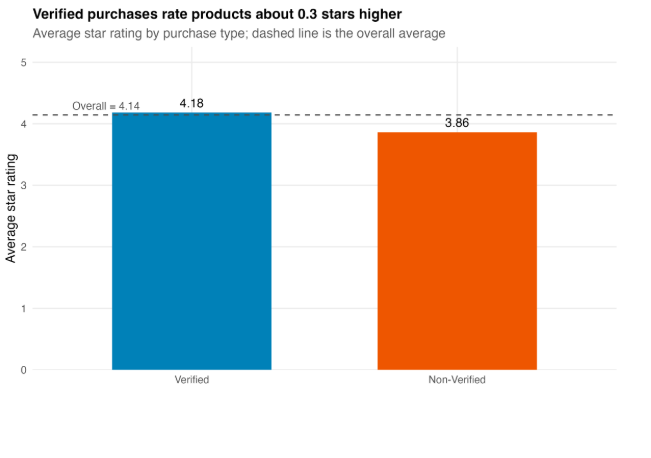
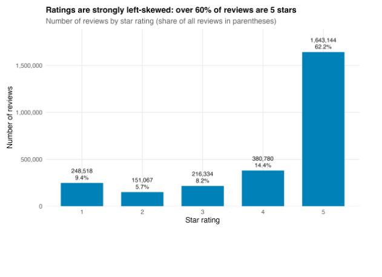
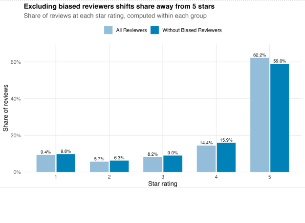
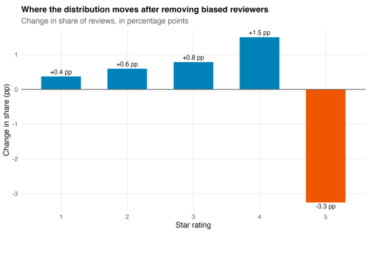
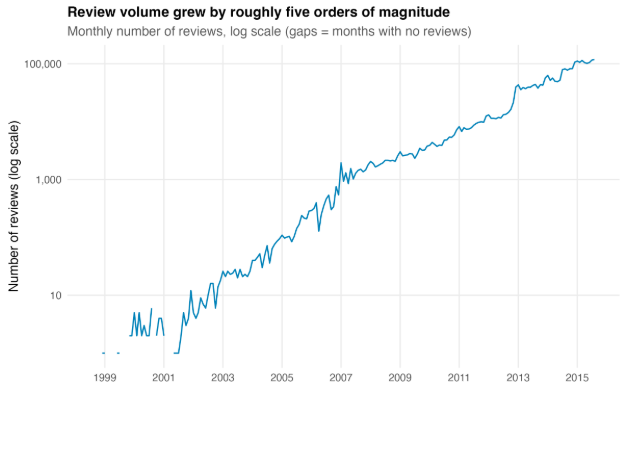
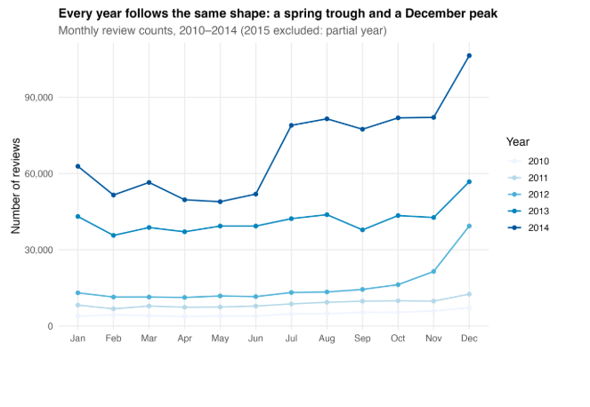
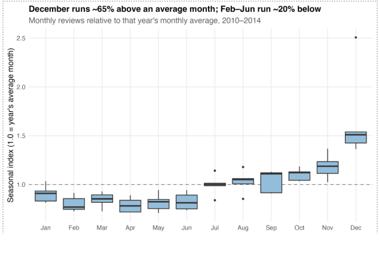

# E-Commerce-Review-Intelligence-Analytics
An end-to-end analytics project examining rating patterns, reviewer behavior, and seasonal activity across **2.6M+ Amazon product reviews**.

Python | MySQL | SQL | R | pandas

## Project Overview
Online marketplaces collect large amounts of customer feedback, but average ratings and review counts provide only part of the picture. This project examines how purchase verification, reviewer behavior, and review timing affect the interpretation of marketplace feedback.

The analysis addresses four questions:
- Do verified and unverified purchases receive different ratings?
- What does the rating distribution reveal beyond the overall average?
- How much do frequent extreme reviewers influence the results?
- How does review activity vary across years and months?

MySQL handled aggregation across the full dataset, Python exported analysis-ready tables, and R supported visualization and interpretation.

## Collaboration
This project was completed collaboratively. This repository focuses on the components and analyses I personally contributed to:
- Built a reusable Python extraction utility that exports selected tables from remote MySQL to CSV, with configurable inputs, logging, error handling, and overwrite protection
- Prepared and worked with SQL outputs covering purchase verification, rating distributions, reviewer behavior, and monthly review activity
- Developed R visualizations and contributed to the interpretation and communication of findings

## Key Findings
## 1. Verified Purchasers Rated Products More Positively

First, compared average ratings across verified and non-verified purchases to determine whether purchasing context was associated with rating behavior.



The overall average product rating was **4.14 stars**. Breaking the reviews apart revealed a noticeable difference:

| Purchase Status | Average Rating |
|---|---:|
| Verified | **4.18** |
| Non-Verified | **3.86** |
| Difference | **+0.32** |

A 0.32-star difference may appear modest on a five-point scale, but marketplace ratings are already concentrated toward the upper end of the scale. The overall mean also sits much closer to the verified-purchase average, indicating that verified reviews make up much of the dataset and strongly influence the headline rating. 

Verified purchasers were associated with **more positive rating behavior**, but this should not be interpreted as evidence that verification itself causes higher ratings. Purchase verification provides useful context when interpreting ratings. However, this comparison is observational: it does not establish that verification itself causes higher ratings. Differences in products or reviewer populations could also contribute to the gap.

---

## 2. The Average Rating Hides a Strongly Positive Distribution

Although the overall average was 4.14 stars, ratings were concentrated at the upper end:



The distribution is heavily concentrated at the top of the rating scale:

| Rating | Reviews | Share |
|---:|---:|---:|
| 1 ★ | 248,518 | **9.4%** |
| 2 ★ | 151,067 | **5.7%** |
| 3 ★ | 216,334 | **8.2%** |
| 4 ★ | 380,780 | **14.4%** |
| 5 ★ | 1,643,144 | **62.2%** |

**4- and 5-star ratings account for 76.6% of all reviews**, while 5-star reviews alone represent nearly two-thirds of the dataset.

But there is another interesting feature: **1-star reviews are more common than either 2- or 3-star reviews.** The middle of the scale is relatively thin, with 2- and 3-star reviews together representing only **13.9%** of reviews.


### Takeaway

The distribution behaves less like a smooth measure of satisfaction and more like a **polarized customer-response signal**. Customers appear especially likely to leave reviews when they are very satisfied and, to a lesser extent, when they are very dissatisfied. This also means the average rating should be interpreted carefully. A relatively small change in the mean could reflect a shift in the proportion of extreme ratings rather than a broad change in customer sentiment.

---

## 3. Excluding Extreme Reviewers Had a Modest Effect

The strongly top-heavy rating distribution raised another question: Could a relatively small group of reviewers who repeatedly give extreme ratings be distorting the marketplace's overall rating profile?

Because reviewer bias cannot be directly observed, I used a behavioral definition to identify **potentially biased reviewers**.

A reviewer was flagged when they:

- submitted at least **5 reviews**, and
- gave either a **1-star or 5-star rating in at least 80%** of those reviews.

This is a behavioral screening rule, not proof of bias or intent.

### Comparing the Rating Distributions



| Rating | All Reviewers | Without Flagged Reviewers | Change |
|---:|---:|---:|---:|
| 1 ★ | 9.4% | 9.8% | **+0.4 pp** |
| 2 ★ | 5.7% | 6.3% | **+0.6 pp** |
| 3 ★ | 8.2% | 9.0% | **+0.8 pp** |
| 4 ★ | 14.4% | 15.9% | **+1.5 pp** |
| 5 ★ | 62.2% | 59.0% | **−3.3 pp** |


After excluding flagged reviewers:
- The five-star share declined from 62.2% to approximately 59.0%
- The average rating declined from approximately 4.14 to 4.08 stars
- Four- and five-star ratings still represented approximately 74.9% of reviews.
- The implied average rating declined from approximately **4.14 to 4.08 stars**.

### Where Did the Distribution Move?



The second view makes the direction of the change clearer.

**Five stars was the only rating category that lost share.**

Every other rating gained share after the flagged reviewers were removed. The behavioral rule captures extreme reviewers at **both ends** of the scale, yet removing them primarily reduces 5-star ratings.

### Takeaway

Potentially biased reviewers appear to contribute some **upward pressure** to marketplace ratings, but the effect is relatively small.

Even after removing them:

- 5 stars remains by far the most common rating;
- 4- and 5-star ratings still represent approximately **74.9%** of reviews; and
- the overall shape of the distribution remains strongly positive.

Therefore, the marketplace's positive rating pattern is **not simply an artifact of a small group of extreme reviewers**. A more interesting finding is the direction of the effect: among frequent reviewers who repeatedly use the extremes of the rating scale, extreme positivity appears more prevalent than extreme negativity.

### Limitation

This metric identifies unusual rating behavior, not intent. A customer who genuinely loved five consecutive products could be flagged in exactly the same way as someone exhibiting systematic rating bias. 
The result should therefore be interpreted as a **sensitivity analysis of reviewer behavior**, not a definitive classification of individual reviewers.

---

## 4. Review Activity Showed Recurring Year-End Peaks

The final analysis examined how marketplace review activity changed over time.

### Long-Term Growth



Monthly review volume grew by roughly **five orders of magnitude**, from only a handful of reviews per month in the earliest years to more than **100,000 reviews per month by mid-2015**. Because that growth is so large, the visualization uses a logarithmic scale. On a standard linear scale, the early years would be compressed near zero and the underlying pattern would be difficult to see.

The approximately linear pattern on the log scale indicates growth closer to **exponential than linear** over much of the period. This creates a problem for seasonality analysis:

> If every year is dramatically larger than the previous one, how can we tell whether December is genuinely unusual or simply belongs to a later, larger year?

---

### Comparing the Shape of Each Year

To isolate recurring within-year behavior, the analysis focused on **2010–2014**. Earlier years contained too few observations for stable monthly comparisons, while 2015 was excluded because the dataset ends partway through the year.



Plotting each year separately reveals a recurring shape:

- activity softens during the spring;
- begins rebuilding during the second half of the year; and
- rises sharply toward December.

However, raw counts still make direct comparisons difficult because 2014 contains far more reviews than 2010. So one additional normalization step was needed.

---

### Normalizing for Marketplace Growth

For each year, monthly review volume was divided by that year's average monthly review count:

```text
Seasonal Index =
Monthly Review Volume
────────────────────────
Average Month in Same Year
```

An index of:

- **1.0** = typical month for that year
- **> 1.0** = above-average month
- **< 1.0** = below-average month



After controlling for the enormous differences in annual scale, the recurring seasonal pattern becomes much clearer.

Across 2010–2014:

- **December** was approximately **65% above an average month** and represented about **13.9% of annual reviews**.
- **November** represented approximately **9.9%** of annual activity.
- **October** represented approximately **9.2%**.
- February through June formed a recurring trough at roughly **20% below an average month**.
- **April (6.6%)** and **February (6.7%)** were among the lowest-volume months.
- Activity generally increased from July through the end of the year.

### Takeaway

Marketplace review activity demonstrates a clear recurring annual pattern:

**spring trough → second-half recovery → December peak**

The December peak is consistent with holiday-period purchasing behavior, although review dates represent when customers submitted reviews rather than when purchases occurred. This normalization adjusts for differences in annual scale, although growth within each year may still contribute to the year-end pattern. The pattern therefore reflects the seasonality of **review activity**, which may lag purchasing behavior.

---

## Technical Approach

### SQL - Aggregate Within the Database

Rather than moving millions of records into R, SQL was used to perform the heavier aggregation work within MySQL.

For the analyses presented here, SQL was used to: calculate average ratings by verification status; aggregate review counts by star rating; identify reviewers meeting the extreme-rating behavioral criteria; recalculate rating distributions after excluding those reviewers; and aggregate review volume by month and year.

This produced smaller analytical tables designed specifically for downstream visualization.

---
# From Database to Analysis

One of my primary technical contributions was developing the Python workflow used to move analytical results from the remote database into the visualization environment.

The reusable command-line utility allows a user to specify:

```text
--table       Database table to retrieve
--outfile     Destination CSV file
--config      Database configuration file
--force       Optionally replace an existing output file
```

For example:

```bash
python download.py \
    --table analysis_table \
    --outfile analysis_table.csv \
    --config connection.yaml
```

The script:

1. reads database settings from a YAML configuration file;
2. establishes a MySQL connection using SQLAlchemy and PyMySQL;
3. retrieves the requested table into a pandas DataFrame;
4. exports the results to CSV for downstream analysis;
5. records progress and errors using Python's logging module; and
6. safely closes the database connection when processing is complete.
   
Logging records connection checks, extraction progress, row counts, and errors. The utility also disposes of the database engine after execution.

---

# Analytical Approach

### SQL - Prepare

SQL handled the heavy processing and created analysis-ready tables for verified-purchase ratings, rating distributions, reviewer bias, and monthly review activity.

### Python - Extract

Python connected the remote MySQL database to the local analysis workflow. pandas, SQLAlchemy, PyMySQL, PyYAML, argparse, and logging supported database access, configurable extraction, CSV output, and execution tracking. 

### R - Visualize & Interpret

R and ggplot2 were used to visualize the prepared datasets and communicate the resulting customer and marketplace patterns.

---

# Repository Structure

```text
e-commerce-review-intelligence-analytics/
│
├── README.md
├── .gitignore
├── requirements.txt
│
├── config/
│   └── connection.example.yaml
│
├── src/
│   ├── python/
│   │   └── download.py
│   │
│   ├── sql/
│   │   └── analysis_review.sql
│   │
│   └── r/
│       └── analysis_visualizations.R
│
└── images/
    ├── verified_purchase.png
    ├── distribution.png
    ├── reviewer_bias.png
    └── ...
```

---

# Running the Extraction Utility

### 1. Install Python dependencies

```bash
pip install -r requirements.txt
```

### 2. Configure the database connection

A template is provided at:

```text
config/connection.example.yaml
```

Create a local `connection.yaml` containing your own database settings:

```yaml
user: YOUR_USERNAME
password: YOUR_PASSWORD
hostname: YOUR_DATABASE_HOST
port: 3306
schema: YOUR_DATABASE
```

Database credentials are intentionally excluded from this repository.

### 3. Download an analytical table

```bash
python src/python/download.py \
    --table TABLE_NAME \
    --outfile OUTPUT.csv \
    --config connection.yaml
```

Use `--force` if an existing output file should be replaced.

---


